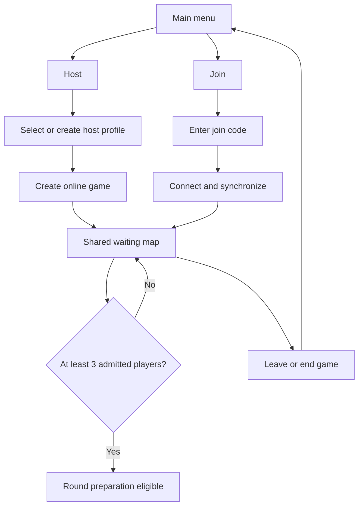

# WhoDunBit — Main Menu and Multiplayer Entry Plan

**Purpose:** Propose the first multiplayer milestone, from the existing main menu to a player-hosted waiting map using Unity Services.  
**Version:** 1.0  
**Created:** 14 October 2026  
**Updated:** 14 October 2026  
**Status:** Proposed implementation plan; no networking implementation completed  
**Related documents:** [Game Design Document](Game%20Design%20Document.md), [Technical Design Document](Technical%20Design%20Document.md), [Initial Project Configuration](Project%20Configuration.md)

## 1. Objective and documented requirements

Deliver a Windows test build in which a player can host from the main menu, select a save profile, enter a shared waiting map, and invite other players using a short join code. Other players can join that running game, including after earlier players have entered the map. Leaving and attempting another connection must work without restarting the application.

The design baseline is GDD 0.5, particularly sections 3.1 and 7, and TDD 0.6, particularly sections 5–7:

- One participating player's machine runs authoritative gameplay initially.
- Unity Services supports initial internet testing; Steam comes later.
- Dedicated servers are a future requirement that should inform separation of responsibilities.
- Hosting follows `Main menu → Host → Select save profile → Load lobby`.
- The lobby is interactive preparation in the map, with protection against player damage, blocking and disruptive hostile effects.
- Waiting is indefinite below three players, counting the host. Reaching three permits normal preparation; the trigger is not yet specified.
- New connections must be possible without recreating the session. Joining during a round does not establish spawning, faction assignment or spectator rules.
- Hidden gameplay information must remain controlled by the authoritative host and sent only to entitled recipients.

This plan recommends implementation choices. It does not turn proposed defaults into adopted gameplay rules or resolve all TDD decisions.

## 2. Current project evidence

At planning time:

- Unity 6000.3.14f1, URP and the new Input System are installed.
- `Assets/Scenes/Main Menu.unity` has a uGUI Canvas and an EventSystem using the Input System UI module.
- A reusable uGUI/TextMeshPro menu-button prefab exists at `Assets/Resources/Prefabs/UI/Buttons/Menu Button.prefab`. Its serialized button callback list is empty.
- `Assets/Scenes/Dev.unity` exists and is the sole scene currently enabled in the build scene list. The main menu is not yet configured as the build entry point.
- The manifest contains Multiplayer Center, but not the Multiplayer Services SDK, Netcode for GameObjects or Multiplayer Play Mode. Multiplayer Center alone does not implement hosting or joining.
- Local project metadata contains a Unity Cloud project association. Dashboard access, development environment and runtime service availability still need verification.
- No project-authored multiplayer/gameplay C# implementation was found in the inspected asset files.

Existing scene, asset and document edits must be preserved. This milestone should extend the current uGUI work.

## 3. Recommended technical route

### Connection management and simulation

Use the unified Multiplayer Services SDK with its Sessions API (`Unity.Services.Multiplayer`) for creation, code-based joining, membership, connection lifecycle and cleanup. Pair it with Netcode for GameObjects (NGO) and Unity Transport in client-server/host mode.

For internet testing, configure `SessionOptions.WithRelayNetwork()`. This provides the intended player-hosted experience through Unity's connection infrastructure rather than requiring players to configure router forwarding. The participating host still simulates the game; Unity's connection infrastructure does not become the authoritative game server. This is relayed host/client connectivity, not a direct all-to-all peer mesh. See [Unity's network connection management](https://docs.unity.com/en-us/mps-sdk/manage-session-network-connection).

Use the primary Sessions API rather than separately implementing the underlying service lifecycle. With networking configured on session creation, the SDK starts the configured network flow for hosts and joining clients. Avoid a second independent `StartHost`/`StartClient` path that could race with it. See [session networking](https://docs.unity.com/en-us/mps-sdk/session-networking).

Start the gameplay network as part of hosting: players must share an interactive map while waiting, even with only one or two players. The three-player gate controls round preparation, not network startup.

### Why NGO is the proposed starting stack

NGO fits the current GameObject/MonoBehaviour project and has a supported integration with Unity's multiplayer package. It avoids adopting an Entities/DOTS architecture solely for menu connectivity. Unity documents this combination in its [NGO integration tutorial](https://docs.unity.com/en-us/mps-sdk/tutorials/build-your-first-session).

The choice is provisional until a short responsiveness test is completed. NGO's documented client anticipation is not a full rollback-and-replay prediction/reconciliation solution. A production FPS controller, hit validation and lag compensation will require deliberate work. Test an authoritative movement/interaction experiment under representative latency before building combat and role systems around the stack. If the result requires disproportionate custom networking work, evaluate alternatives at that checkpoint. See [client anticipation](https://docs.unity3d.com/Packages/com.unity.netcode.gameobjects@2.13/manual/advanced-topics/client-anticipation.html).

Do not copy tutorial shortcuts into game authority: the sample's client-authoritative movement and legacy input setup are not decisions for WhoDunBit. Retain the existing new Input System and keep consequential gameplay host-controlled.

### Packages to resolve during implementation

| Package | Purpose |
|---|---|
| `com.unity.services.multiplayer` | Unified multiplayer connection/session operations |
| `com.unity.netcode.gameobjects` | Host/server gameplay replication, messages, network objects and scene synchronization |
| `com.unity.transport` | Transport used by NGO; resolve the compatible dependency and expose it directly only if project code needs a direct reference |
| `com.unity.services.authentication` | Anonymous test-player sign-in; verify the SDK dependency and add a direct reference if required |
| `com.unity.multiplayer.playmode` | Multiple local test players in Editor tooling |

Select released versions compatible with 6000.3.14f1 through Package Manager and commit the resulting manifest and lockfile. The table identifies dependencies, not a request to install every item independently or upgrade existing packages. No networking packages were installed during planning. [Unity installation guidance](https://docs.unity.com/en-us/mps-sdk/install-and-upgrade).

## 4. Proposed first-milestone defaults

| Question | Proposed choice | Status / scope |
|---|---|---|
| How players join | Private game with a shareable join code | Suitable for initial friend testing; a public browser can follow |
| Identity | Anonymous Unity Authentication sign-in | Prototype identity; no account-creation screen |
| Test capacity | Four total players, configurable | Test value to exercise the three-player threshold and a later join; not a final lobby limit |
| Host departure | End the game and return clients to the menu | No simulation host migration in this milestone |
| Reconnection | Clean disconnect and normal code-based joining again | Does not restore a previous role, inventory or in-round participation |
| Player counting | Count fully synchronized players admitted by the host | Recommended threshold semantics, including the fully loaded host |
| Round trigger | Host-controlled start enabled only at three admitted players | Recommendation to adopt when timed preparation is added; first milestone implements the gate, not rounds |
| Early population drop | Return to waiting if population drops below three before timed preparation starts | Proposed; population loss during timed preparation/active rounds remains a separate design decision |
| Save profile | Minimal local, versioned host-settings profile | Preserves required selection flow without assuming world/progression saves |

The initial milestone has no active rounds. If a test-only phase is added to exercise late synchronization, it must not silently determine production rules for joining an active round.

Use a simple local host-profile record: stable profile ID, display name, schema version and initial host settings, such as test capacity and map key. A first-use default profile can keep selection usable. Profile storage/creation UI should remain small; migration and corrupt-file handling should return a clear error or offer creation of a clean profile without silently deleting data. These fields and first-use behaviour are proposals because the GDD leaves profile contents open.

Host save profiles are separate from Authentication profiles. For local multiplayer tests, each instance needs a distinct authenticated player identity; selecting a different host save must not change online identity. Unity supports [separate Authentication profiles](https://docs.unity.com/en-us/authentication/profile-management) and [anonymous initialization/sign-in](https://docs.unity.com/en-us/mps-sdk/init-ugs).

## 5. Player flow and menu scope

Extend the existing Canvas/menu button rather than replacing the UI framework. The first screens need Host, Join and Quit; profile selection; join-code entry; progress/error feedback; and an in-map waiting panel with code/copy, participant names/count, and leave/end-game actions. Starting a second host/join operation while one is pending must be prevented. Menu status should distinguish service initialization, connection, map loading and synchronization.

Use a restrained, readable layout consistent with the visual direction. Keyboard navigation, clear focus, code paste and responsive layouts should work. Do not add speculative settings, monetization or account screens to this milestone.

A connected-player list is appropriate in waiting preparation. It must not evolve into an active-round survival list; future role/death information must follow the GDD disclosure rules.

## 6. Responsibility boundaries

Keep a small number of clear responsibilities rather than a general multiplayer framework:

| Responsibility | Owns |
|---|---|
| Application/bootstrap | One persistent lifetime, dependency creation, Unity Services initialization and test identity |
| Menu presentation/controller | User intent, profile/code entry, progress/errors; no direct ownership of network lifecycle |
| Host profile store | Local profile serialization, validation and versioning; no online membership or secret role state |
| Multiplayer connection coordinator | The SDK session reference, serialized host/join/leave operations, cancellation/late completions, events and cleanup |
| Authoritative waiting-state controller | Player admission/readiness, waiting phase, minimum-player gate and public replicated state |
| Scene flow | Local menu entry/return and host-directed synchronized map loading |

Separate waiting-state and later gameplay logic from Unity service objects. A thin boundary for online operations is enough to protect menu/gameplay code from later Steam integration. It does not make changing NGO or the transport cost-free. Future dedicated hosting should start the same authoritative game flow using supplied settings, without loading a local host menu or save-profile picker.

Keep one persistent network manager/coordinator alive through menu-to-map transitions. Put `Main Menu.unity` first in the build scene list and include the selected shared map. Use the existing Dev scene as the initial test map if appropriate; a dedicated lobby/map asset can follow when its content is defined. Avoid a rename or scene replacement merely for networking setup.

The host directs shared map transitions through NGO scene management. Joining clients should synchronize to the host's current map/state before being counted as admitted players. Regular local scene loading is appropriate when returning to the menu after network teardown. Unity documents [integrated scene management](https://docs.unity.cn/Packages/com.unity.netcode.gameobjects@2.13/manual/integrated-management.html).

## 7. Hotjoining, authority and cleanup

- Keep the running game joinable while capacity remains. Do not lock it just because three players have arrived.
- Treat service membership, network connection, map synchronization and gameplay admission as separate states. Only the authoritative admitted count controls the round gate.
- On entry, synchronize durable permitted state, such as waiting phase and public participant information. Do not rely solely on transient messages sent before the player joined. NGO provides [state synchronization for late joiners](https://docs.unity.cn/Packages/com.unity.netcode.gameobjects@2.13/manual/advanced-topics/ways-to-synchronize.html).
- Add compatibility/admission checks before gameplay participation, including protocol/build compatibility and capacity. Validate client-originated requests on the host. Do not trust a client-supplied identity string as proof of authentication.
- Do not add faction, role, Human Form or undiscovered-death data to public service properties. Future per-player knowledge needs targeted disclosures; hiding shared data in the UI is insufficient.
- Enter waiting preparation with no player collision/blocking and no damage/hostile-effect pathways. A minimal movement/avatar and one shared interaction can validate occupancy and synchronization. Full weapons, role abilities and general prop physics are later work.
- A canceled operation may still finish remotely. If it does, clean up the resulting membership/game rather than allowing stale callbacks to load a map after the user returned to the menu.
- Client departure should leave membership and stop its network, unsubscribe callbacks and return to a usable menu. Repeated cleanup must be safe.
- Graceful host termination should delete the game using the host API, then clean local networking. Merely leaving can elect a new service owner and is not equivalent to ending the game. See [delete a session](https://docs.unity.com/en-us/mps-sdk/delete-a-session) and [leave a session](https://docs.unity.com/en-us/mps-sdk/leave-a-session).
- On unexpected host loss, clients should end their local game and show a reason. Service ownership reassignment must not be mistaken for successful simulation migration. Unity distinguishes owner election from transfer of gameplay state in its [host migration documentation](https://docs.unity.com/en-us/mps-sdk/session-host-migration).

## 8. Implementation sequence and exit checks

| Step | Work | Exit check |
|---|---|---|
| 1. Validate setup | Verify existing Cloud association, service access and development environment; resolve compatible packages; configure unique local test identities | At least three local instances initialize and authenticate as different players |
| 2. Prove online lifecycle | Implement thin connection coordinator; private host/join-by-code; normal leave and host end-game handling | A second player connects to a real hosted game; both can return to the menu and repeat |
| 3. Connect the existing UI | Wire Host/profile picker, Join/code entry, busy/error/cancel states, Quit and in-map status | Actual user flow works without console commands and double-clicks cannot duplicate requests |
| 4. Synchronize the waiting map | Persist bootstrap; register menu/map in builds; host-directed map load; minimal avatars/interaction; public waiting state | Players share the map; two players stay waiting; the host gate becomes eligible only after three fully admitted players |
| 5. Prove hotjoining and recovery | Add a fourth player after the map is running; test leaving/rejoining, failures and host loss | New player receives current state without a restart; failures leave a usable menu and no duplicate network managers |
| 6. Verify over the internet | Produce Windows development build; test separate machines/home networks and inspect relevant service usage | At least one host and two clients connect through the menu from independent networks without manual port forwarding |
| 7. Evaluate FPS networking fit | Small host-authoritative movement/interaction latency experiment before wider gameplay | Record perceived responsiveness, correction behaviour and observed costs; decide whether to retain NGO before combat/roles depend on it |

Steps 1–6 complete the main-menu/connectivity milestone. Step 7 is the immediate architecture checkpoint before substantial FPS implementation; connectivity success alone does not validate movement quality.

## 9. Test matrix

| Case | Expected result |
|---|---|
| One host, then one client | Shared waiting map; no timed preparation below three |
| Third player synchronizes | Host reports threshold eligibility only after admission |
| Fourth player joins later | Same running game/map; current permitted state received |
| Two players race for last slot | Capacity upheld; rejected player gets a clear message |
| Blank, invalid, expired or full code | Clear failure and retry; no half-connected UI |
| Repeated Host/Join clicks | One operation and at most one active membership/network |
| Cancel during authentication/connect/load | Safe return; late completion is cleaned up |
| Client leaves and joins again | Fresh admission; no duplicate player or network manager |
| Host ends game or process closes | Clients exit cleanly; no accidental simulation migration |
| Profile file missing/corrupt | Recoverable profile error; no silent data deletion |
| Late map load/failure or protocol mismatch | No premature admission or round threshold increment |
| Different home networks | Host/join flow works through Unity-managed connectivity |
| Request to change host-owned state | Rejected or validated by host; clients cannot force round start |

Use focused automated tests for the gate, operation lifecycle and profile validation, plus multi-instance/internet tests for actual connections and scene transitions. Do not substitute mocked service results for the real online acceptance test.

## 10. Deferred scope and decision points

The first milestone does not require combat, hidden-role allocation, full timed round progression, a public game browser, automatic matchmaking, voice chat, Steam integration, cloud-hosted simulation, world saves, cosmetic progression, mod distribution or simulation host migration.

The proposed join-code visibility, four-player test capacity, loaded-player count, minimal profile contents and manual future round trigger should be reviewed when implementation begins. Full mid-round spawning/spectating, population loss after preparation begins, reconnect restoration and final player limits remain open design decisions.

No gameplay documents or project settings were changed to adopt this plan. Record accepted choices in the GDD/TDD as implementation proceeds.

## Revision history

| Date | Revision |
|---|---|
| 14 October 2026 | 1.0 — Proposed Unity Services host/join route, existing uGUI integration, profile flow, waiting gate, hotjoining and staged acceptance tests. |
